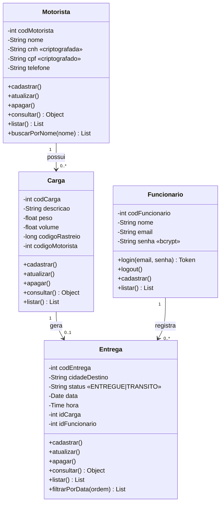
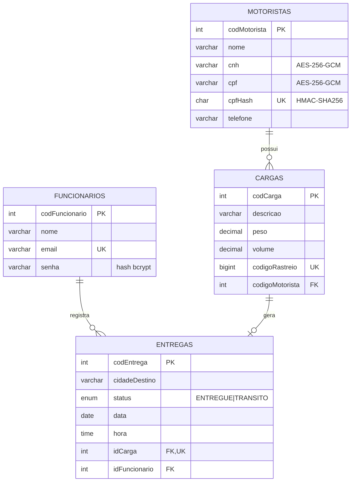

# Sistema de Gestão e Rastreamento de Encomendas — Logística Express

Documentação da refatoração do sistema corporativo interno (acesso restrito à rede interna, uso por funcionários cadastrados e autenticados).

---

## 1. Requisitos

### 1.1 Requisitos Funcionais (RF)

| Cód. | Requisito |
|------|-----------|
| RF01 | O sistema deve autenticar o funcionário por **e-mail e senha**, validando as credenciais no banco. |
| RF02 | O sistema deve manter a sessão do funcionário por **180 minutos**, exigindo novo login após esse prazo. |
| RF03 | O sistema deve permitir **logout**, encerrando a sessão e retornando à tela de login. |
| RF04 | A página principal deve exibir o **funcionário logado**, o **menu de navegação** e o botão de **logout** no topo. |
| RF05 | O sistema deve permitir **cadastrar funcionários** (por funcionário autenticado), armazenando a senha criptografada. |
| RF06 | O sistema deve **cadastrar motoristas** (nome, CNH, CPF e telefone). |
| RF07 | O sistema deve **listar e consultar motoristas** em tabela, com CNH e CPF **descriptografados** para exibição. |
| RF08 | O sistema deve **atualizar e excluir motoristas** (CRUD completo). |
| RF09 | O sistema deve **buscar motoristas por nome** (busca parcial, sem diferenciar maiúsculas/minúsculas). |
| RF10 | O sistema deve **cadastrar cargas** vinculadas a um motorista, com descrição, peso, volume e **código numérico de rastreio**. |
| RF11 | O sistema deve **listar, consultar, atualizar e excluir cargas**, exibindo o motorista responsável. |
| RF12 | O sistema deve **cadastrar entregas** vinculadas a uma carga, com cidade destino, status (`ENTREGUE`/`TRANSITO`), data e hora. |
| RF13 | O sistema deve **atualizar o status** (e demais dados) de uma entrega e permitir sua exclusão. |
| RF14 | O sistema deve **listar entregas em tabela com filtro e ordenação por data** (crescente/decrescente), além de filtro por período, status e cidade. |
| RF15 | O sistema deve exibir um **resumo** (contadores) na página principal. |

### 1.2 Requisitos Não Funcionais (RNF)

| Cód. | Requisito |
|------|-----------|
| RNF01 | **Segurança de senha:** senhas de funcionários armazenadas com hash **bcrypt** (custo 10); nunca em texto puro. |
| RNF02 | **Criptografia de dados sensíveis:** CNH e CPF armazenados com **AES-256-GCM** (IV aleatório por registro + tag de autenticação). |
| RNF03 | **Acesso restrito à rede interna:** o servidor recusa (HTTP 403) IPs fora de loopback e das faixas privadas 10/8, 172.16/12, 192.168/16 e fc00::/7. |
| RNF04 | **Proteção contra SQL Injection:** todo acesso ao banco via ORM Sequelize (consultas parametrizadas) e validação de entrada. |
| RNF05 | **Proteção contra XSS:** o frontend monta o DOM com `textContent` (sem `innerHTML` com dados) e o servidor aplica **Content-Security-Policy** (Helmet). |
| RNF06 | **Segurança HTTP:** cabeçalhos de segurança (Helmet), `X-Powered-By` desativado, limite de corpo de 100 kB, **rate-limit** de login (20 tentativas/15 min por IP). |
| RNF07 | **Mensagens de erro seguras:** login retorna a mesma mensagem para e-mail inexistente ou senha incorreta; erros internos não expõem *stack trace*. |
| RNF08 | **Acessibilidade:** idioma `pt-BR`, link "Ir para o conteúdo", `nav` com `aria-label`, `aria-current`, rótulos associados aos campos, foco visível, regiões `aria-live` para mensagens e tabelas com `caption`/`scope`. |
| RNF09 | **Usabilidade/responsividade:** interface adaptável a telas pequenas; tabelas com rolagem horizontal. |
| RNF10 | **Integridade e manutenibilidade:** chaves estrangeiras `RESTRICT`, restrições `UNIQUE`/`CHECK`, código organizado em camadas (rotas → controllers → models) e **testes automatizados** (45 casos). |

### 1.3 Regras de Negócio (RN)

| Cód. | Regra |
|------|-------|
| RN01 | O acesso ao sistema é permitido **somente a funcionários cadastrados e autenticados**. |
| RN02 | A sessão tem duração máxima de **180 minutos**; após isso o token é rejeitado (HTTP 401) e o usuário volta ao login. |
| RN03 | **CNH e CPF** dos motoristas são sempre gravados criptografados e **nunca exibidos criptografados** nas telas/consultas. |
| RN04 | O **CPF** deve ser válido (dígitos verificadores) e **único** entre os motoristas; a **CNH** deve ter 11 dígitos; o telefone deve ter DDD (10 ou 11 dígitos). |
| RN05 | Toda **carga** deve estar associada a **um motorista existente** e conter descrição, peso (> 0 kg), volume (> 0 m³) e código de rastreio. |
| RN06 | O **código de rastreio** é numérico, com **exatamente 11 dígitos**, e **único** por carga. |
| RN07 | Toda **entrega** deve estar relacionada a **uma carga cadastrada**, e cada carga possui **no máximo uma entrega**. |
| RN08 | O status da entrega só pode ser **`ENTREGUE`** ou **`TRANSITO`**; uma entrega já `ENTREGUE` **não pode voltar** para `TRANSITO`. |
| RN09 | Se data/hora não forem informadas no cadastro da entrega, o sistema usa a **data e hora atuais**. |
| RN10 | **Não é permitido excluir** motorista que possua cargas, nem carga que possua entrega (integridade referencial → HTTP 409). |
| RN11 | O funcionário que registra a entrega fica gravado na própria entrega (rastreabilidade). |

---

## 2. Requisitos de Infraestrutura

| Item | Especificação (versão testada) |
|------|--------------------------------|
| Banco de dados | **MySQL 8.x** (compatível; testado em **MariaDB 10.11.14**) — banco `db_logistica`, charset `utf8mb4` |
| Linguagem | **JavaScript / Node.js v22.22.2** (npm 10.9.7) — mínimo recomendado: Node 18+ |
| Framework back-end | Express **5.3.0**, Sequelize **6.37.8**, mysql2 **3.24.6** |
| Segurança | bcryptjs 2.4.3, jsonwebtoken 9.0.3, helmet 8.3.0, express-rate-limit 7.5.1 |
| Servidor web local | **Node.js + Express** em `http://localhost:3000` (API em `/api`) |
| Frontend | **HTML5 + CSS3 + JavaScript (ES2020) puro**, servido como arquivos estáticos pelo próprio Express |
| Ferramenta de teste | **Jest 29.7.0 + Supertest 7.3.1** (testes de integração da API). Opcional: Postman/Insomnia para testes manuais |
| Navegador | Google Chrome / Microsoft Edge / Firefox (versões atuais) |
| Modelagem | UML (diagrama de classes) e modelo lógico em `diagramas_UML/` |

---

## 3. Modelagem

### 3.1 Diagrama de Classes
Arquivo: `diagramas_UML/diagramasDe_Classe.png` (fonte Graphviz: `diagramasDe_Classe.dot`).



### 3.2 Modelo Lógico
Arquivo: `diagramas_UML/reverseEnginner.png` (fonte: `modelo_logico.dot`).



> **Observação:** a coluna `cpfHash` (HMAC do CPF) é interna: serve apenas para garantir a unicidade do CPF sem armazená-lo em claro (o CPF criptografado muda a cada gravação por causa do IV aleatório). Ela nunca é retornada pela API.

### 3.3 Script do banco de dados
Arquivo: `database/script_db_logistica.sql` — cria o banco `db_logistica`, as 4 tabelas (PK, FK, UNIQUE, CHECK) e insere **3 registros em cada tabela**.

---

## 4. API — rotas (todas sob `/api`)

| Método | Rota | Descrição | Auth |
|--------|------|-----------|:----:|
| GET | `/health` | Verificação de funcionamento | — |
| POST | `/auth/login` | Login → `{ token, expiraEm, funcionario }` | — |
| GET | `/auth/me` | Funcionário logado | ✔ |
| POST | `/auth/logout` | Logout | ✔ |
| GET / POST | `/funcionarios` | Listar / cadastrar funcionário | ✔ |
| GET | `/motoristas?nome=` | Listar / **buscar por nome** | ✔ |
| POST | `/motoristas` | Cadastrar | ✔ |
| GET / PUT / DELETE | `/motoristas/:id` | Consultar / atualizar / excluir | ✔ |
| GET / POST | `/cargas` | Listar / cadastrar | ✔ |
| GET / PUT / DELETE | `/cargas/:id` | Consultar / atualizar / excluir | ✔ |
| GET | `/entregas?ordem=asc\|desc&dataInicial=&dataFinal=&status=&cidade=` | Listar com **filtro e ordenação por data** | ✔ |
| POST | `/entregas` | Cadastrar entrega de uma carga | ✔ |
| GET / PUT / DELETE | `/entregas/:id` | Consultar / **atualizar status** / excluir | ✔ |

Autenticação: cabeçalho `Authorization: Bearer <token>`.

Códigos usados: `200/201` sucesso · `400` validação · `401` não autenticado/expirado · `403` fora da rede interna · `404` não encontrado · `409` conflito (duplicidade/integridade/regra de status) · `500` erro interno.

---

## 5. Testes

### 5.1 Teste de integração da API (código implementado)
Arquivo: `backend/tests/api.test.js` — Jest + Supertest, executado contra um banco real e **separado** (`db_logistica_test`, recriado a cada execução, para não afetar os dados de `db_logistica`).

```bash
cd backend
npm test
```

Cobertura (45 casos): login válido/inválido; expiração em 180 min (token com `exp - iat = 10800 s`) e token expirado/ inválido → 401; hash bcrypt no banco; restrição de rede interna; CRUD de motoristas; CNH/CPF criptografados no banco e descriptografados na resposta; busca por nome; CPF inválido/duplicado; cargas (validação de peso, volume e rastreio de 11 dígitos, motorista inexistente, duplicidade); entregas (criação, data/hora padrão, ordenação asc/desc, filtros por período/status/cidade, atualização de status, bloqueio `ENTREGUE → TRANSITO`); integridade referencial (409); JSON malformado, cabeçalhos de segurança e tentativa de SQL Injection.

### 5.2 Teste manual de rotas (curl)

```bash
# 1) login
curl -s -X POST http://localhost:3000/api/auth/login \
  -H "Content-Type: application/json" \
  -d '{"email":"carlos@logisticaexpress.com","senha":"Senha@123"}'

# 2) use o token retornado
TOKEN="cole_o_token_aqui"
curl -s http://localhost:3000/api/motoristas?nome=ana -H "Authorization: Bearer $TOKEN"
curl -s "http://localhost:3000/api/entregas?ordem=asc&dataInicial=2026-10-01" -H "Authorization: Bearer $TOKEN"
curl -s -X PUT http://localhost:3000/api/entregas/1 -H "Authorization: Bearer $TOKEN" \
  -H "Content-Type: application/json" -d '{"status":"ENTREGUE"}'
```

---

## 6. Como executar

```bash
# 1. Banco: crie tudo pelo script SQL...
mysql -u root -p < database/script_db_logistica.sql
#    ...OU pelo Sequelize (cria o banco/tabelas e depois insere os 3 registros iniciais)
cd backend
npm install
# ajuste usuário/senha do MySQL e os segredos em config/config.js
npm run sync && npm run seed

# 2. Servidor (API + frontend)
npm start                # http://localhost:3000

# 3. Login de teste
#    carlos@logisticaexpress.com / Senha@123
```

> Use **uma** das duas formas de criar o banco (script SQL **ou** `sync + seed`). O script SQL usa a `chaveCripto` de `config/config.js`; se você trocar a chave, use `npm run sync && npm run seed` para que CNH/CPF dos registros iniciais sejam legíveis.

---

## 7. Correções feitas no código original

| Problema encontrado | Correção |
|---------------------|----------|
| `index.js` e 3 controllers (`Entrega`, `Funcionarios`, `Motorista`) **vazios**; sem rotas, sem frontend | Implementados (rotas, controllers, app Express, frontend completo) |
| `auth.middleware.js`: `cryptoJS` vs `CryptoJS` (ReferenceError), `res.status(401),json(...)` (erro de sintaxe lógica), header `autorization` (typo) e **sem tempo de expiração real** | Reescrito com **JWT** (`Authorization: Bearer`), expiração de **180 min** e tratamento correto de erros |
| Chave secreta `'segredo'` fixa no código | Segredos centralizados em `backend/config/config.js` (sem `.env`) |
| Senha/CPF/CNH sem criptografia nos models/controllers (o controller criptografava o rastreio e **gravava o valor em claro**) | Senha com **bcrypt**; CNH/CPF com **AES-256-GCM**; rastreio gravado como número |
| `codigoRastreio` como `INT` (11 dígitos **estouram** o INT) | `BIGINT` + validação de 11 dígitos + `UNIQUE` |
| `valores.codigoRastreio.length` em número (falha) e validação exigia só peso/volume/rastreio/motorista (esquecia descrição) | Validação completa e tipada em todos os campos |
| Mensagens "Erro ao cadastrar **ciclista**" (copiado de outro projeto) | Mensagens corrigidas |
| `Entrega` com colunas redundantes (`idMotorista`, `codCarga` duplicando `idCarga`) e `onDelete: CASCADE` (apagava entregas silenciosamente) | Modelo normalizado; FKs `RESTRICT`; 1 entrega por carga |
| `Carga` sem FK real para `Motorista` | Relação `Motorista 1—N Carga` com FK |
| `sync({force:true})` sem criar o banco | `sync.js` cria o banco `db_logistica` se não existir |
| Sem testes, sem documentação, diagramas desatualizados | Testes de integração, documentação e diagramas regenerados |
